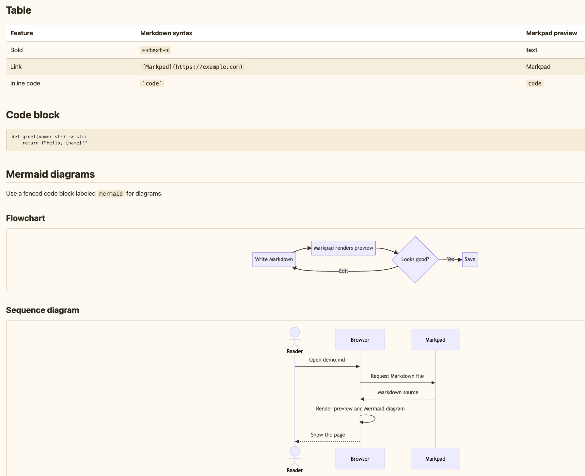

# markpad

[English](README.md) | [简体中文](README.zh-CN.md)

`markpad` 是一个本地 Markdown 编辑器、阅读器和翻译工具。可在包含 Markdown 文件的目录中运行，浏览文件、编辑 Markdown，并实时查看 HTML 预览。

## 安装

需要 **Python 3.11+** 和 [uv](https://docs.astral.sh/uv/getting-started/installation/)。

### 一键安装

下载并运行安装脚本（获取最新的 `main` 源码，然后运行 `install.sh`）：

```bash
curl -fsSL https://raw.githubusercontent.com/walterfan/markpad/main/bootstrap.sh | bash
```

从其他分支安装时，可设置 `MARKPAD_BRANCH`：

```bash
curl -fsSL https://raw.githubusercontent.com/walterfan/markpad/main/bootstrap.sh | MARKPAD_BRANCH=develop bash
```

### 从本地克隆安装

```bash
git clone https://github.com/walterfan/markpad.git
cd markpad
./install.sh
```

安装脚本会构建软件包，将其安装到 `~/.local/share/markpad/venv`，并在 `~/.local/bin` 创建 `markpad` 命令链接。使用以下命令检查安装：

```bash
markpad --help
```

卸载虚拟环境和命令链接：

```bash
./install.sh uninstall
```

如果通过一键安装，且本地没有仓库副本，可重新下载 `install.sh`，或克隆仓库后运行 `./install.sh uninstall`。

## 运行

在包含 Markdown 文件的目录中运行：

```bash
markpad
```

也可以显式指定根目录：

```bash
markpad /path/to/markdown
markpad --root /path/to/markdown
markpad serve /path/to/markdown
```

可以直接打开指定的 Markdown 文件，包括绝对路径。浏览器 URL 会保留文件路径，再次打开该 URL 时会显示对应文件的 Markdown 源码和渲染预览：

```bash
markpad docs/guide.md --open
# 打开 http://localhost:9526/docs/guide.md

markpad /Users/me/notes/today.md --open
# 在页面中并排显示文件的 Markdown 源码和渲染后的 HTML 预览
```

在网页左侧的搜索框中，也可以输入任意 Markdown 文件的绝对路径并按 Enter 打开，例如 `/Users/me/notes/today.md`。随后可在同一页面中编辑并保存文件。

默认情况下，服务监听 `127.0.0.1:9526`。如果端口 `9526` 已被占用，会依次尝试 `9527`、`9528` 等端口。也可指定端口：

```bash
markpad --port 9030
```

无需启动服务即可检查安装和运行环境：

```bash
markpad doctor
markpad doctor --format json
```

## 护眼主题

顶部工具栏的 `Theme` 设置菜单提供三种阅读主题：

- **Clear**：清爽的浅色主题，使用现代系统字体。
- **Paper**：温暖的纸张背景，使用衬线字体。
- **Dark**：适合低光环境的柔和深色主题。

设置保存在浏览器的 `localStorage` 中。

文件树带有独立滚动条，便于浏览较大的目录。工具栏上的三个图标可分别显示或隐藏文件树、Markdown 编辑区和 HTML 预览区。

## LLM 翻译

工具栏中的 `Translate` 按钮默认将选中的 Markdown 文本翻译成中文。如果没有选中文本，则翻译整个编辑器内容。配置好 shell 环境变量或启动目录中的 `.env` 文件后，该按钮即可使用：

```bash
MP_LLM_BASE_URL=https://api.example.com/v1
MP_LLM_MODEL=your-model
MP_LLM_API_KEY=your-api-key
# 只有当 LLM 服务使用可信的自签名证书时，才设为 false。
MP_LLM_VERIFY_SSL=false
```

`MP_LLM_BASE_URL` 可以是 OpenAI 兼容 API 的基础 URL（例如 `/v1`），也可以直接指向 `/chat/completions`。

## 开发

```bash
uv sync
uv run markpad --help
uv run ruff check .
uv run ruff format .
uv run pytest
```

## 图表

Mermaid 代码块会在浏览器中渲染。如果本机配置了 PlantUML 命令，PlantUML 代码块也会被渲染：

```bash
export MARKPAD_PLANTUML_CMD=plantuml
```

查看 [example/demo.md](example/demo.md)，了解 Markdown 和 Mermaid 的渲染效果。

本地 Markdown 图片链接按 Markdown 文件所在目录解析。图片必须位于服务所选的根目录内，包括通过绝对路径打开 Markdown 文件时。


