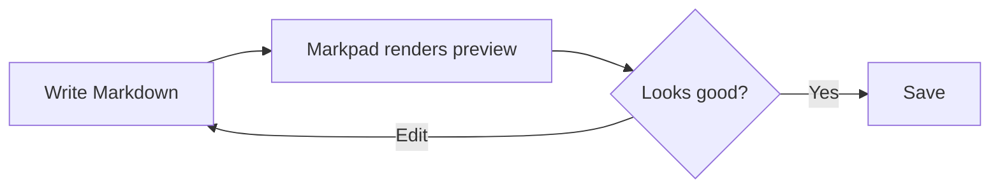
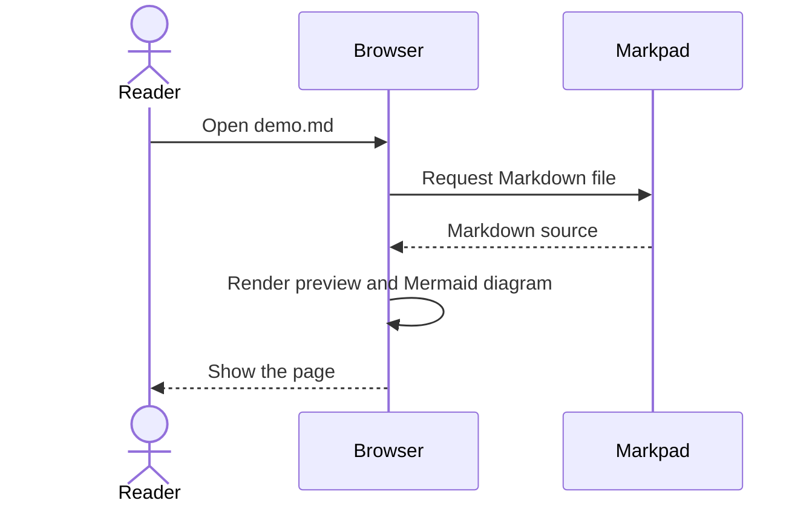
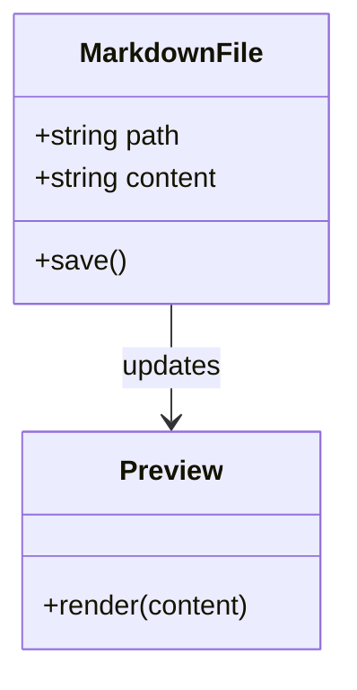
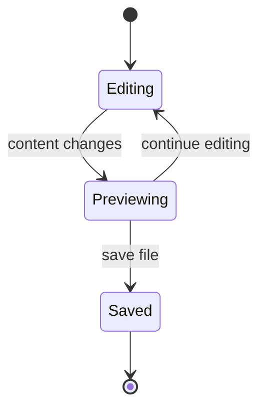

# Markpad Markdown Demo

This page shows Markdown features that Markpad can render. Open it in Markpad and
edit the source to see the preview update.

## Text and headings

Use **bold**, *italic*, ~~strikethrough~~, and `inline code` in a sentence.

> Blockquotes are useful for notes, tips, and excerpts.
>
> They can contain multiple paragraphs.

## Lists

Shopping list:

- Coffee
- Tea
  - Green tea
  - Black tea
- Water

Steps to preview a file:

1. Start Markpad in the folder containing the file.
2. Select `example/demo.md` in the file list.
3. Edit the Markdown and watch the preview update.

## Table

| Feature | Markdown syntax | Markpad preview |
| --- | --- | --- |
| Bold | `**text**` | **text** |
| Link | `[Markpad](https://example.com)` | [Markpad](https://example.com) |
| Inline code | `` `code` `` | `code` |

## Code block

```python
def greet(name: str) -> str:
    return f"Hello, {name}!"
```

## Mermaid diagrams

Use a fenced code block labeled `mermaid` for diagrams.

### Flowchart



### Sequence diagram



### Class diagram



### State diagram



## Links and horizontal rule

Visit the [Markpad repository](https://github.com/walterfan/markpad) for more information.

---

That is the end of the demo page.
